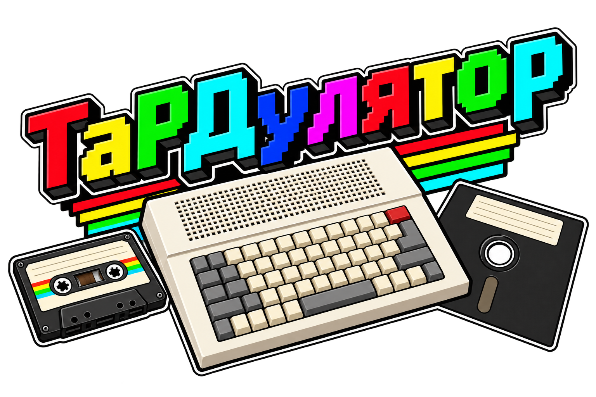

# ТаРДулятор / TaRDulator

[Русский](#russian) · [English](#english) · [Скачать / Download](https://github.com/madcatse/TaRDulator/releases/latest)

## Русский

**ТаРДулятор переносит программы ZX Spectrum с кассет TAP/TZX на диски TR-DOS.** Создавайте сборники с собственным экранным меню или диск с одной программой, которая запускается сразу. Приложение работает в Windows, а готовый TRD предназначен для эмулятора или Spectrum-совместимого компьютера с Beta Disk / TR-DOS.

### Скачать и запустить

Текущая версия — **0.10.1**. Скачайте **`TaRDulator-v0.10.1-win-x64.zip`** со [страницы релиза](https://github.com/madcatse/TaRDulator/releases/tag/v0.10.1), распакуйте всю папку `TaRDulator` и запустите `TaRDulator.exe`.

Нужны **Windows 10/11 x64 и .NET Framework 4.8**. Установка приложения и Python не требуется; все компоненты конвертера находятся в архиве. Сохраняйте папки `engine`, `help` и остальные файлы рядом с EXE. Программа работает без подключения к интернету.

### Возможности

- Загрузка **TAP и поддерживаемых TZX** с автоматическим или ручным выбором **48К / 128К**, сохранением дополнительных банков памяти и состояния AY для 128К-программ.
- **Сборники с меню**: до 16 программ на странице, автоматическое создание страниц, русские и латинские подписи. Либо **одна программа без меню**.
- **Визуальный редактор**: расположение надписей, цвета и яркость, одна или две колонки, собственные заголовки и подсказки.
- **Фон меню**: импорт Spectrum SCR, преобразование PNG/JPEG/BMP в экран 256 × 192, экспорт фона и готовой страницы в SCR.
- **Сохранение оформления** в `.t2menu` для повторного использования. Макет содержит фон и оформление страниц; кассеты и названия игр в него не входят.
- **Расчёт занятого места** до создания TRD, сжатие данных и отчёт `.report.json` с параметрами и журналом конвертации.
- **Профили совместимости** для отдельных программ и вариантов кассет, в том числе некоторых составных загрузок. Профили выбираются по полному SHA-256 файла, а не по его названию.
- **Русский и английский интерфейс**, подробная автономная справка по кнопке **«Справка» / F1**.

Один TRD имеет размер 640 КиБ: для данных доступно 636 КиБ и 128 записей каталога. Меню и загрузчики тоже занимают место, поэтому число программ зависит от их размера.

### Как происходит перенос

В обычном режиме ТаРДулятор выполняет кассетный загрузчик в эмуляции Spectrum средствами **SkoolKit**, сохраняет подготовленное состояние памяти и процессора, затем использует **Z80to** для сжатия и создания дискового загрузчика. Полученные файлы записываются в TRD; для сборника добавляется меню.

Для некоторых известных кассет предусмотрены отдельные способы переноса частей программы и точечные исправления. Перед исправлением проверяются хеш кассеты и ожидаемые байты кода. Список распознаваемых вариантов и подходящие параметры есть в разделе **«Профили»** встроенной справки.

Это не универсальная замена любых обращений к кассете: нестандартные загрузчики, последующая подгрузка уровней и сохранение на ленту могут требовать отдельного профиля. Поддержка TZX зависит от используемых в нём команд. Подробности — в [русской справке](help/index.ru.html).

### Краткая инструкция

1. Нажмите **«Добавить программы»** или перетащите TAP/TZX в окно. Задайте названия и порядок пунктов.
2. Для обычной конвертации оставьте **«Модель → Авто»**, **«Перенос на диск → Авто (Z80to)»**, а поле **«Старт»** — пустым. При необходимости используйте параметры из справки для вашей кассеты.
3. Выберите фон и настройте меню: надписи можно перетаскивать мышью. Сохраните оформление в `.t2menu`, если хотите использовать его снова. Для единственной программы можно выбрать **«Одна программа без меню»**.
4. Нажмите **«Рассчитать размер»**, чтобы проверить вместимость диска, затем **«Создать TRD»** и выберите, куда сохранить образ. Расчёт выполняет загрузку и упаковку, поэтому может занять некоторое время.
5. Откройте TRD в эмуляторе или на компьютере с Beta Disk / TR-DOS. Для сборника выполните `RUN "boot"` из TR-DOS, если меню не появилось автоматически. В режиме без меню выполните `RUN`.

В меню дискеты клавиши **1–9, A–G** запускают программу, **N** открывает следующую страницу, **P** — предыдущую; страницы переключаются по кругу. Для возвращения из игры используйте сброс и повторную загрузку диска.

Исходные TAP/TZX не изменяются. Игры в комплект не входят. Файл `.report.json` рядом с готовым TRD помогает разобраться в результате конвертации.

### Справка и обратная связь

Откройте **F1** в приложении или [русскую HTML-справку](help/index.ru.html). Расширенное описание параметров и работы с меню — в [USAGE.md](USAGE.md).

О проблемах сообщайте через [Issues](https://github.com/madcatse/TaRDulator/issues): укажите версию приложения, параметры конвертации, SHA-256 кассеты, модель Spectrum и фрагмент журнала. Игровой образ прикладывать не нужно.

### Лицензия и благодарности

Собственный код ТаРДулятора распространяется по **GNU GPL версии 3 или более поздней**: [LICENSE](LICENSE), [область действия лицензии](LICENSING.md). Исходники приложения и соответствующие исходники SkoolKit входят в архив выпуска.

Спасибо авторам компонентов, на которых основана программа:

| Компонент | Авторы | Назначение и лицензия |
| --- | --- | --- |
| [SkoolKit](https://skoolkit.ca/) | Richard Dymond и участники проекта | Эмуляция загрузки и снимки; GPL-3.0-or-later |
| [Z80to](https://github.com/TomDDG/Z80to) | Tom Dalby (TomDDG) | Сжатие и дисковые загрузчики; MIT |
| [Python](https://www.python.org/) | Python Software Foundation и участники проекта | Среда выполнения конвертера; PSF License и включённые уведомления |
| [PyInstaller](https://pyinstaller.org/) | Авторы и участники PyInstaller | Автономная упаковка; GPL с исключением для загрузчика |

Используются также ROM и стандартный шрифт Sinclair ZX Spectrum, а для кириллицы — глифы из Windows’91. Их происхождение, отдельные условия и известные сведения об авторстве приведены в [THIRD_PARTY.md](THIRD_PARTY.md); тексты лицензий — в [licenses/](licenses/). Автор и лицензия шрифта Windows’91 в исходном материале не указаны; лицензия собственного кода не распространяется на чужие ресурсы.

Для желающих участвовать в разработке: [CONTRIBUTING.md](CONTRIBUTING.md) и [сборка из исходников](RELEASING.md).

---

## English

**TaRDulator converts ZX Spectrum programs from TAP/TZX tapes to TR-DOS disks.** Create collections with your own on-screen menu, or a disk containing one program that starts directly. The application runs on Windows; the resulting TRD is intended for an emulator or a Spectrum-compatible computer with Beta Disk / TR-DOS.

### Download and run

The current version is **0.10.1**. Download **`TaRDulator-v0.10.1-win-x64.zip`** from the [release page](https://github.com/madcatse/TaRDulator/releases/tag/v0.10.1), extract the complete `TaRDulator` folder, and run `TaRDulator.exe`.

Requires **Windows 10/11 x64 and .NET Framework 4.8**. No application or Python installation is needed; the archive includes the converter's runtime components. Keep `engine`, `help` and the other files beside the EXE. The application works offline.

### Features

- **TAP and supported TZX** loading with automatic or manual **48K / 128K** selection, retaining additional RAM banks and AY state for 128K programs.
- **Collections with a menu**: up to 16 programs per page, automatic pagination, and Russian or Latin labels. Alternatively, **one program without a menu**.
- **Visual editor**: text positioning, colours and brightness, one or two columns, custom headings and hints.
- **Menu background**: import Spectrum SCR, convert PNG/JPEG/BMP to a 256 × 192 screen, and export the background or a completed menu page as SCR.
- **Save layouts** as `.t2menu` for reuse. A layout contains the background and page styling; it does not include tapes or game titles.
- **Calculate disk usage** before creating a TRD, compress data, and save conversion settings and logs in a `.report.json` report.
- **Compatibility profiles** for specific programs and tape variants, including some multipart loads. Profiles match the complete file SHA-256, rather than its name.
- **Russian and English interface**, with a detailed offline manual available through **Help / F1**.

A TRD is 640 KiB: 636 KiB and 128 directory entries are available for data. The menu and loaders also use space, so the number of programs depends on their size.

### How conversion works

In the standard mode, TaRDulator executes the tape loader in Spectrum emulation using **SkoolKit**, captures the initialized memory and CPU state, then uses **Z80to** for compression and disk loader generation. It writes the resulting files to a TRD and adds a menu for a collection.

Some recognized tapes have dedicated methods for transferring program parts and applying targeted fixes. Both the tape hash and the expected code bytes are checked before a fix is applied. The built-in manual's **Profiles** section lists recognized variants and suitable settings.

This does not universally replace every tape operation: custom loaders, later level loading and tape saving may require a dedicated profile. TZX support depends on the commands used in the file. See the [English manual](help/index.en.html) for details.

### Quick start

1. Click **Add programs**, or drag TAP/TZX files into the window. Set the menu titles and their order.
2. For normal conversion, keep **Model → Auto**, **Disk conversion → Auto (Z80to)**, and leave **Start** blank. Where necessary, use the settings specified for your tape in the manual.
3. Choose a background and arrange the menu: drag text with the mouse. Save the layout as `.t2menu` if you want to reuse it. For a single program, you can select **One program without a menu**.
4. Click **Calculate size** to check disk capacity, then **Create TRD** and choose where to save the image. Calculation performs loading and compression, so it may take some time.
5. Open the TRD in an emulator or on a computer with Beta Disk / TR-DOS. For a collection, run `RUN "boot"` from TR-DOS if the menu does not appear automatically. In the mode without a menu, run `RUN`.

In the disk menu, keys **1–9, A–G** launch a program, **N** opens the next page, and **P** the previous page; navigation wraps around. To return from a game, reset the computer and load the disk again.

Input TAP/TZX files remain unchanged. No games are included. The `.report.json` file beside the completed TRD helps explain the conversion result.

### Help and feedback

Press **F1** in the application or open the [English HTML manual](help/index.en.html). An extended description of settings and menu editing is available in [USAGE.md](USAGE.md), in Russian.

Report problems through [Issues](https://github.com/madcatse/TaRDulator/issues): include the application version, conversion settings, tape SHA-256, Spectrum model and a relevant log excerpt. You do not need to attach the game image.

### License and acknowledgments

TaRDulator's own code is released under **GNU GPL version 3 or later**: see [LICENSE](LICENSE) and [license scope](LICENSING.md). The release archive includes the application sources and the corresponding SkoolKit sources.

Thank you to the authors of the components on which the application is built:

| Component | Authors | Purpose and license |
| --- | --- | --- |
| [SkoolKit](https://skoolkit.ca/) | Richard Dymond and contributors | Loading emulation and snapshots; GPL-3.0-or-later |
| [Z80to](https://github.com/TomDDG/Z80to) | Tom Dalby (TomDDG) | Compression and disk loaders; MIT |
| [Python](https://www.python.org/) | Python Software Foundation and contributors | Converter runtime; PSF License and included notices |
| [PyInstaller](https://pyinstaller.org/) | PyInstaller authors and contributors | Standalone packaging; GPL with a bootloader exception |

The application also uses Sinclair ZX Spectrum ROMs and the standard ROM font, plus glyphs from Windows’91 for Cyrillic text. Their provenance, separate terms and known authorship information are recorded in [THIRD_PARTY.md](THIRD_PARTY.md); license texts are in [licenses/](licenses/). The source material does not identify the Windows’91 font's author or license; the license for TaRDulator's own code does not cover third-party resources.

To contribute to development, see [CONTRIBUTING.md](CONTRIBUTING.md) and the [source build instructions](RELEASING.md).
